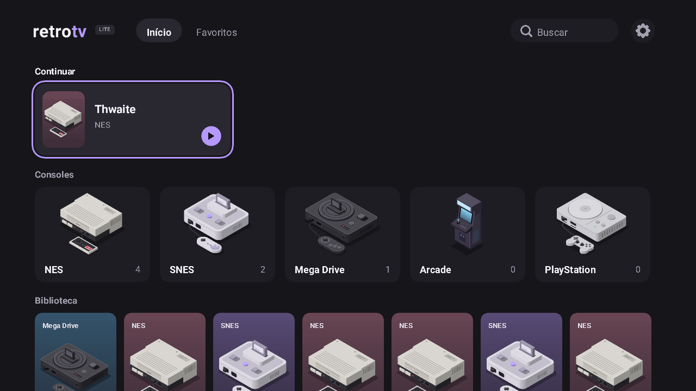
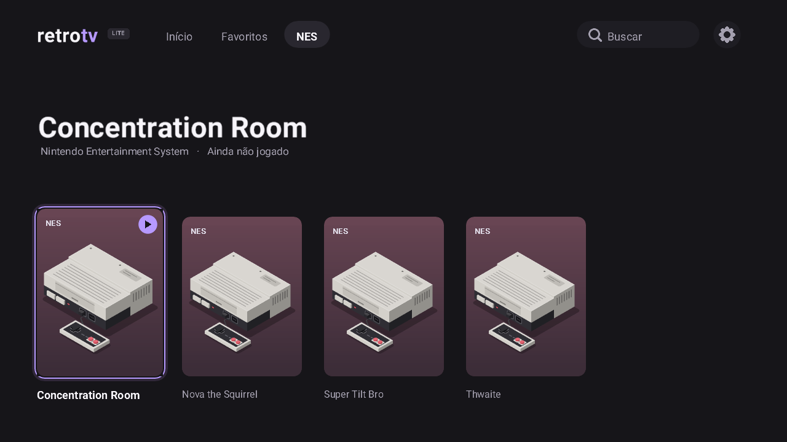
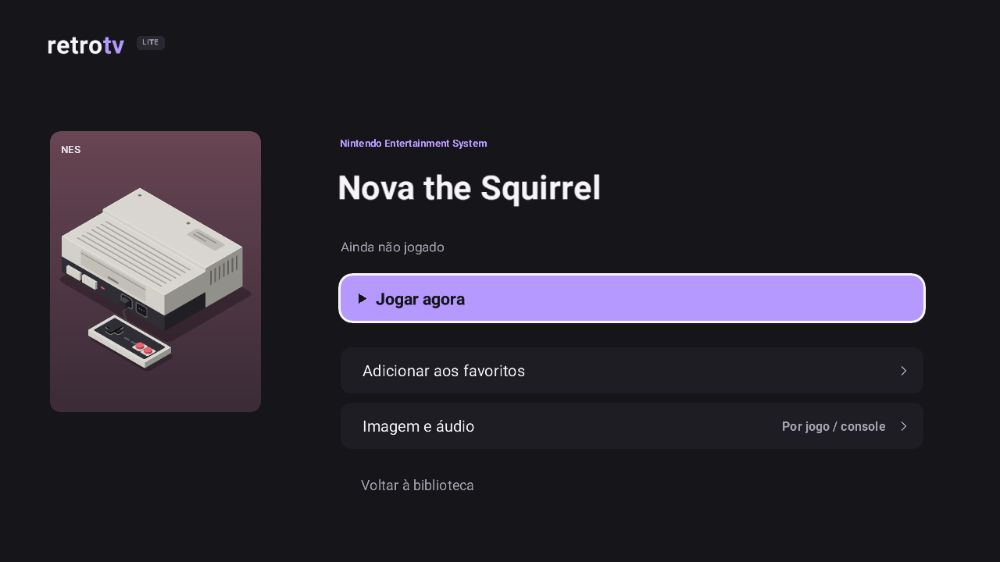
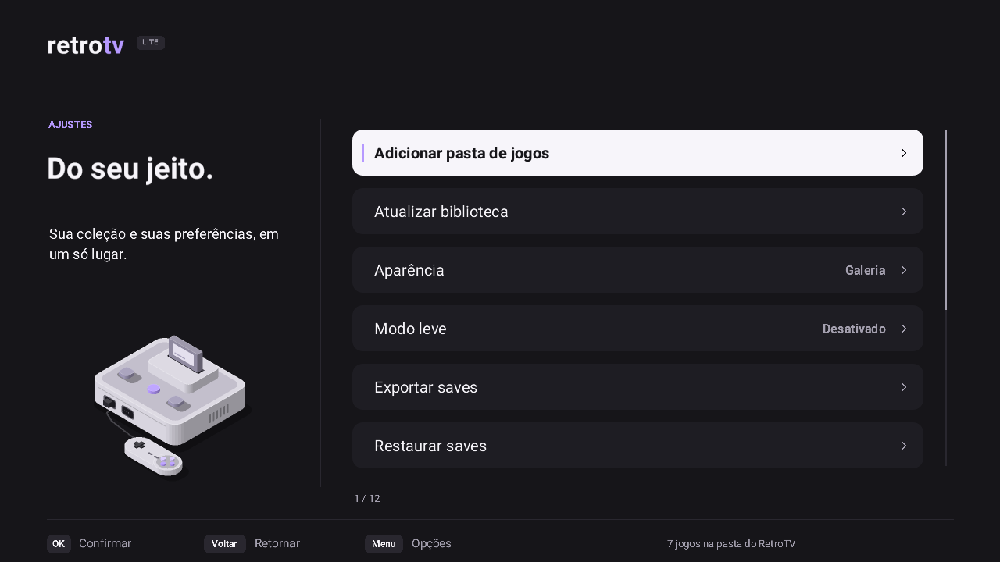

# RetroTV Lite

Frontend de jogos retrô para **Android TV de entrada**, em C++17/SDL2/GLES2 + Kotlin. Interface própria, offline e feita para o controle remoto. Versão de desenvolvimento **0.7.3-dev**; não é uma release 1.0 certificada.

**Por que "Lite":** o app foi pensado para o hardware das TVs mais simples, e não para celulares ou TV boxes potentes. Os limites abaixo valem para todas as decisões de interface e de emulação:

| Recurso | Perfil Lite (alvo) |
|---|---|
| Sistema | Android TV 8.0+ (testado em Android TV 11) |
| CPU | ARMv7 de **32 bits** (`armeabi-v7a`), 4 núcleos da classe Cortex-A53/A7 |
| Memória | cerca de **1 GiB** de RAM, dividido com o sistema da TV |
| GPU | **OpenGL ES 2.0** (classe Mali-400/450/470); sem Vulkan nem GLES 3 |
| Consoles | NES, SNES, Mega Drive/Master System, Arcade CPS1/CPS2 e PS1. N64, GameCube e Wii ficam fora: exigem GLES 3, 64 bits ou mais memória |

Inclui biblioteca SQLite, pastas de jogos (USB pelo seletor do Android ou pasta interna do app), favoritos/recentes, aparência Galeria (com capas locais) ou Minimal, modo leve, host Libretro próprio (sem a interface do RetroArch), perfis de imagem/áudio por jogo e por console, menu rápido, SRAM, save states/Quick Resume condicionais, backup/restore validado e controles com remapeamento. Também tem controle pelo celular ([RetroTV Pad](https://github.com/RetroGame-TV/retrotv-pad)) ou pelo navegador. A demo NES original CC0 permite testar sem nenhuma ROM. Para capas: `Nome do jogo.png` (ou jpg/jpeg/webp) ao lado da ROM, com o mesmo nome base. Veja a [especificação visual](docs/ui-spec.md).

**Validação e limitações:** leia [docs/progress.md](docs/progress.md) e a [matriz dos cores](docs/core-compatibility.md).
- **Testado** no Android TV virtual x86 e numa TV de referência real com o perfil acima: NES, SNES e Mega Drive rodando, e controle pelo celular por Wi-Fi.
- **Ainda sem medição:** desempenho (FPS/memória), Arcade e PS1 em aparelho real, e Bluetooth RFCOMM entre aparelhos.
- Scraper, perfis de usuário e editor de frameskip por console continuam pendentes.

## Como é

Capturas da versão 0.7.3 no Android TV virtual (1280x720). Os jogos da biblioteca são homebrew de distribuição livre; as imagens mostram a arte de console do próprio RetroTV.

| Início | Biblioteca do console |
|---|---|
|  |  |
| **Detalhes do jogo** | **Ajustes** |
|  |  |

O controle pelo celular fica no [RetroTV Pad](https://github.com/RetroGame-TV/retrotv-pad), ou em qualquer navegador (iPhone incluso) pela porta 47801 da TV.

## Compilar no Windows

Java 17+ (usado JDK 21), Gradle wrapper 8.9, AGP 8.7.3, Kotlin 2.0.21. Instale os componentes oficiais:

```powershell
git submodule update --init --recursive
sdkmanager 'platforms;android-35' 'build-tools;35.0.0' 'ndk;26.3.11579264' 'cmake;3.22.1' 'platform-tools'
$env:ANDROID_HOME = 'C:\Android\Sdk' # ajuste ao seu SDK
.\scripts\build.ps1 -Sdk $env:ANDROID_HOME -Release
```

No ZIP de fontes as dependências já acompanham o pacote; o primeiro comando é necessário para um clone Git, não para o ZIP. Caminho curto é recomendado no Windows para builds NDK. Não há ferramentas globais obrigatoriamente instaladas pelo projeto.

Saídas: `app/build/outputs/apk/debug/app-debug.apk` (assinado com chave **debug de desenvolvimento** gerada pelo Android); `app/build/outputs/apk/release/app-release-unsigned.apk` (sem assinatura release). Não há credenciais/chaves release no fonte. Gere e guarde sua chave fora do repositório para distribuição real.

QuickNES compila pelo CMake; PCSX ReARMed compila pelo script a partir da revisão fixa, sem download de .so em runtime. Para **experimento privado** dos cores com restrições de licença:

```powershell
.\scripts\build.ps1 -Sdk $env:ANDROID_HOME -PrivateCores
```

Essa variante reúne os cores principais no mesmo APK, mas **não está liberada para distribuição**: veja [licenças](docs/licenses.md). Não é um launcher de aplicativos externos.

Linux/CI: `pwsh ./scripts/build-cores.ps1 -Sdk "$ANDROID_HOME"` e `bash ./gradlew :app:testDebugUnitTest :app:lintDebug :app:assembleDebug`. O workflow em `.github/workflows/` está preparado, mas não foi executado no GitHub nesta entrega.

## Instalar e usar

Habilite depuração Android TV e conecte ADB pelo método suportado pela TV. Consulte `adb devices` e use explicitamente o serial desejado:

```powershell
.\scripts\adb-install.ps1 -Serial 'SERIAL_DA_TV' -Apk '.\app\build\outputs\apk\debug\app-debug.apk'
```

Abra RetroTV Lite pelo launcher. Use D-pad/OK/Voltar; Menu abre configurações. Primeiro teste: **Ajustes > Testar controle**. Depois escolha a subpasta USB contendo seu acervo legal. Para PS1, importe sua BIOS; formatos e VFS ainda dependem de validação. Nunca inclua jogos/BIOS sem direitos de uso.

Antes de usar progresso importante, teste save convencional, snapshot, exportação e restauração com arquivos descartáveis. [Manual de saves](docs/saves.md), [controles](docs/controls.md), [USB](docs/usb-storage.md), [testar na TV de referência](docs/test-on-tv.md) e [troubleshooting](docs/troubleshooting.md).

## Testes

```powershell
.\gradlew.bat :app:testDebugUnitTest :app:lintDebug
cmake -S native -B build/native -DRETROTV_TESTS=ON
cmake --build build/native
ctest --test-dir build/native --output-on-failure
```

São testes reais de QuickNES e políticas de navegação/saves/VFS. Testes Android adicionais usam provider sintético apenas no debug. Variante exclusiva para emulador: `-PtestAbi=x86` (saídas em `app/build-emulator/`; não entregar para a TV ARM).

A entrada do jogo é coletada depois da espera do quadro; o canal do celular mantém os analógicos mais recentes e preserva os toques curtos e as sequências digitais. A validação inclui SDL/QuickNES reais e receptor TCP no Android TV virtual. Veja [entrada, testes de botões e limites](docs/input-latency.md).

Controle Bluetooth pelo celular e troca automática de layout: veja docs/phone-controller.md. Exige RetroTV Pad no celular; a sincronização é opcional e desligada por padrão.
